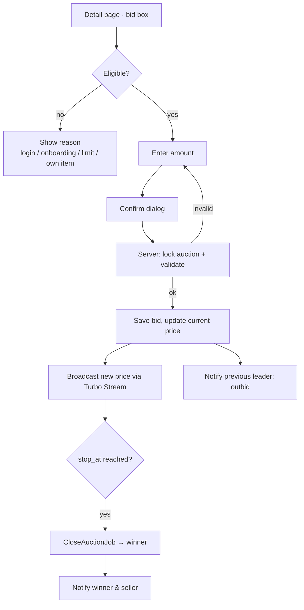

# M4 — Bidding Flow (Draft)

Placing bids, real-time price updates, closing auctions, and choosing the winner for each of the three auction types (English, Dutch, Sealed).

> **Status:** plan only. **Depends on:** M1 (bidder must be onboarded, with a bid limit from their credit grade), M2 (auctions), M3 (detail page hosts the bid box).

## Flow overview



## Who can bid (all types)

- Logged in, and M1 onboarding confirmed
- Not the seller of the item
- Auction status is `live` (`start_at ≤ now < stop_at`)
- Amount ≤ the bidder's **bid limit from their credit grade** (A ฿200k, B ฿100k, C ฿30k, D ฿5k)

## Rules per auction type

### English (ประมูลขึ้นราคา, price goes up)
- First bid ≥ starting price; after that, bid ≥ current price + minimum increment
- A user can't outbid themselves while they are the leading bidder
- **Anti-sniping:** a bid in the last 2 minutes pushes `stop_at` back by 2 minutes
- At close: highest bid wins **only if it's ≥ the reserve price**; otherwise the auction ends with no winner

### Dutch (ประมูลลดราคา, price goes down)
- The price starts at the starting price and drops by `drop_amount` every `drop_interval` until it reaches `floor_price`
- The current price is calculated from the time, not stored on every tick: `max(floor, start − drops_elapsed × drop_amount)`
- **First "Buy at ฿X" wins** and the auction closes straight away. If two people click at the same moment, the auction lock ensures only one wins
- If it reaches the floor and the stop time passes with no taker, the auction ends with no winner

### Sealed (ประมูลซองปิด, sealed bids)
- **One bid per user**, which can't be changed or seen by others (v1)
- Bid ≥ starting price; the price panel shows only the number of bids
- At close: bids are revealed, highest wins if ≥ reserve; a tie goes to whoever bid earliest

## Placing a bid (server side)

```
Auction.transaction do
  auction.lock!                       # row lock; keeps concurrent bids in order
  validate eligibility + type rules   # against the locked, fresh state
  bid = auction.bids.create!(...)
  auction.update!(current_price:, bids_count:, leader_id:, stop_at: extended?)
end
broadcast + enqueue notifications after commit
```

The confirm dialog shows the amount, the auction type rules, and that **a bid is a binding commitment**.

## Real-time updates

- Turbo Streams over Action Cable (`solid_cable` is already in the Gemfile). Each auction has its own stream (`auction_<id>`)
- What's broadcast: price panel, bid history row, countdown when `stop_at` is extended, bid box state
- Sealed broadcasts only the bid count
- The Dutch price drop happens in the browser countdown (Stimulus), and the server checks the price again when someone accepts

## Closing auctions

- **`CloseAuctionJob`** (Solid Queue, already in the Gemfile) is scheduled for `stop_at` and re-scheduled if the auction is extended
- A recurring sweep every minute closes any auction that was missed
- Close sets `closed_at`, `winner_id`, `final_price` and status `ended`, then notifies the winner, the seller and the losing bidders
- Closing a second time does nothing (guarded by `closed_at`)

## Notifications (v1: in-app, shown on My Event)

| Event | Recipient |
|---|---|
| You were outbid | Previous leader (English) |
| Auction ending in 15 min | Bidders + watchers |
| You won / You didn't win | Bidders |
| Your item sold / didn't sell | Seller |

## Data additions

```
bids:          id, auction_id, user_id, amount, created_at
               index (auction_id, amount DESC), unique (auction_id, user_id) for Sealed
auctions(+):   bids_count, leader_id, final_price
notifications: id, user_id, auction_id, kind, read_at, created_at
```

## Routes

| Method | Path | Purpose |
|---|---|---|
| POST | `/auctions/:id/bids` | Place bid (English, Sealed) |
| POST | `/auctions/:id/accept` | Buy at current price (Dutch) |
| GET | `/notifications` | In-app notifications |

## Tests

- English: minimum increment, can't outbid yourself, anti-sniping extension, reserve not met → no winner
- Dutch: price at given times, floor reached, two simultaneous accepts → exactly one winner
- Sealed: one bid per user, no price shown before close, earliest bid wins a tie
- Common: eligibility rules (guest, not onboarded, seller, over bid limit, not live)
- Close job runs safely twice; the sweep closes missed auctions
- System test: two browser sessions see the price update live

## Open questions

1. Can a bid ever be retracted (e.g. a typo within 1 minute)?
2. Should there be proxy / auto-bidding (bidder sets a maximum, the system bids for them)?
3. What happens when the winner doesn't pay: offer to second place, and/or a penalty that lowers their credit grade?
4. Should the bid limit apply to each auction, or to the total of all the bidder's leading bids?
5. Do we need SMS/email notifications in v1, or is in-app enough?
