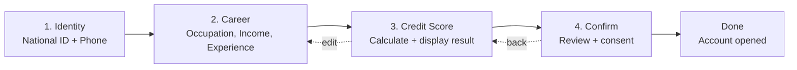

# User Onboarding Flow (Draft)

A 4-step sign-up wizard that verifies a bidder's identity, collects career and income details, calculates a credit score, and asks the user to confirm before their bidder account is opened.

> **Status:** plan only, not implemented. The app has no DB models yet (auctions use mock data), so v1 keeps answers in the encrypted Rails session. When a `User` model exists, that session storage is replaced with a saved record.

## Flow overview

## Steps

### Step 1 — Identity (ยืนยันตัวตน)

| Field | Input | Validation |
|---|---|---|
| National ID | text, `inputmode=numeric` | 13 digits; must pass the Thai ID check digit (below). Dashes and spaces are removed. |
| Phone number | tel | Thai mobile: 10 digits starting `06`, `08` or `09` (`/\A0[689]\d{8}\z/`). Dashes and spaces are removed. |

**Thai ID check digit:** multiply digits 1–12 by weights 13 down to 2 and add them up. The 13th digit must equal `(11 − sum % 11) % 10`.

Example valid ID for tests: `1101700230708`.

### Step 2 — Occupation, Income, Experience (อาชีพและรายได้)

| Field | Input | Validation |
|---|---|---|
| Occupation | select | One of: `government`, `employee`, `business`, `freelance`, `student`, `other` |
| Annual income (THB) | text, `inputmode=numeric` | Whole number ≥ 0; commas allowed (`1,200,000`) |
| Years of experience | number | Whole number 0–60 |

Submitting this step calculates the credit score and goes to step 3.

### Step 3 — Credit Score Result (ผลเครดิตสกอร์)

This step has no inputs. It shows:
- The score (300–900) as a ring/gauge
- The grade and its label
- The maximum bid allowed per auction
- A table showing how many points each factor added

Actions: **← Edit info** (back to step 2) and **Next →**.

### Step 4 — Review & Confirm (ยืนยัน)

- A summary of all answers. The national ID is masked (`1-XXXX-XXXXX-70-8`) and the phone is formatted (`081-234-5678`).
- The score, grade and bid limit
- A required consent checkbox: *"ข้าพเจ้ายืนยันว่าข้อมูลถูกต้อง และยินยอมให้ใช้ข้อมูลเพื่อประเมินวงเงินประมูล"* ("I confirm this information is correct and consent to it being used to assess my bidding limit")
- **Confirm** opens the account and goes to the Done page. The flow is then locked.

### Done page

A success message, the score card, **Go to auctions →**, and **Start over** (clears the session).

## Credit scoring model (draft)

Score = **300 (base)** + income points + experience points + occupation points. Maximum is **900**.

**Annual income** (max 250)

| Annual income | Points |
|---|---|
| ≥ 1,200,000 | 250 |
| ≥ 600,000 | 200 |
| ≥ 360,000 | 150 |
| ≥ 180,000 | 90 |
| < 180,000 | 30 |

**Years of experience** (max 200): 20 points per year, capped at 10 years.

**Occupation** (max 150)

| Occupation | Points |
|---|---|
| Government / state enterprise | 150 |
| Company employee | 120 |
| Business owner | 100 |
| Freelance | 70 |
| Other | 60 |
| Student | 40 |

**Grade → bid limit per auction**

| Grade | Score | Label | Max bid |
|---|---|---|---|
| A | ≥ 750 | ดีเยี่ยม (Excellent) | ฿200,000 |
| B | ≥ 650 | ดี (Good) | ฿100,000 |
| C | ≥ 550 | พอใช้ (Fair) | ฿30,000 |
| D | < 550 | ต้องปรับปรุง (Needs improvement) | ฿5,000 |

Example: employee, ฿420,000/yr, 4 years → 300 + 150 + 80 + 120 = **650 → Grade B (฿100,000)**.

## Routes & navigation

| Method | Path | Purpose |
|---|---|---|
| GET | `/onboarding` | Sends the user to the first step they haven't finished (or to Done) |
| GET | `/onboarding/:step` | Shows a step (`identity`, `career`, `score`, `confirm`) |
| PATCH | `/onboarding/:step` | Submits a step (`identity`, `career`, `confirm`) |
| GET | `/onboarding/done` | Success page (only once confirmed) |
| DELETE | `/onboarding` | Start over (clears the session) |

**Rules**
- Users can go back to finished steps, but asking for a later step sends them to the first unfinished one.
- Once confirmed, every step redirects to `/onboarding/done`.
- A failed check re-shows the step with `422` and error messages next to each field.

## Implementation outline (Rails 8, matching current codebase)

| File | Responsibility |
|---|---|
| `app/models/onboarding.rb` | ActiveModel form object: attributes, per-step validations (`on: :identity` / `:career` / `:confirm`), input normalisation, `current_step`, `complete?(step)` |
| `app/models/credit_score.rb` | Scorecard constants, `value`, `percent`, `grade`, `bid_limit`, `breakdown` |
| `app/controllers/onboardings_controller.rb` | `show` / `edit` / `update` / `done` / `destroy`; only accepts the current step's fields; blocks skipping ahead |
| `app/helpers/onboardings_helper.rb` | `masked_national_id`, `formatted_phone`, `field_errors` |
| `app/views/onboardings/edit.html.erb` + `steps/_*.html.erb` | Step progress bar + one partial per step; shared `_score_card` |
| `app/views/onboardings/done.html.erb` | Success page |
| `app/assets/stylesheets/onboarding.css` | Reuses colour tokens from `home.css` and `.btn` from `auctions.css` |
| `config/routes.rb` | Routes above |
| Auctions profile menu | Add "สมัครสมาชิก" (Sign up) → `/onboarding` |

**Accessibility:** step progress bar uses `aria-current="step"`; inputs use `aria-invalid` + `aria-describedby` pointing to their error message; score ring has an `aria-label` that states the score.

## Tests

- **`CreditScore`**: the score at each income bracket boundary; the experience cap; each grade threshold; the minimum (300) and maximum (900) cases.
- **`Onboarding` validations**: valid and invalid ID check digit; wrong ID length; phone prefixes; inputs containing commas and dashes; the consent checkbox.
- **Integration**: the full flow from identity to done; skipping ahead redirects; an invalid submission returns 422; the flow is locked after confirm; start over clears it.

## Open questions

1. **Score formula:** is this draft scorecard acceptable, or will scores come from a credit bureau (NCB) or an external scoring service?
2. **Bid limit:** should the grade really limit bidding, or is the score only shown to the user?
3. **Phone verification:** should step 1 include an SMS one-time code (OTP)?
4. **Personal data / PDPA:** v1 keeps the national ID in the encrypted session cookie. For production, encrypt it in storage (`encrypts :national_id`), record consent with a timestamp, and define how long the data is kept.
5. **Duplicates:** what should happen if a national ID or phone number is already registered?
