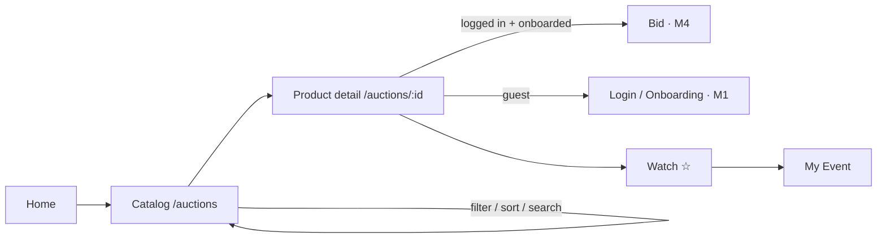

# M3 — Product Catalog Flow (Draft)

How buyers find auctions and look at them in detail. It builds on the existing `/auctions` list page, which currently runs on mock data, and adds search, more filters, a product detail page, and the sidebar's **My Event** page.

> **Status:** plan only. **Depends on:** M2, for real `Product` / `Auction` data. Browsing is public; bidding and *My Event* require M1.

## Flow overview



## 1. Catalog list (`/auctions`)

**Already built (mock):** status chips with counts (live / upcoming / ended), price range, sort (ending soon, price low→high, high→low), pagination of 6 per page, countdown, a "closing soon" style when under 6 hours.

**To add**

| Feature | Detail |
|---|---|
| Search | `q` matches title and description (SQL `LIKE` in v1) |
| Category filter | Chips or select, using the M2 categories |
| Auction type filter | English / Dutch / Sealed |
| Sort | Add "newest" and "most bids" |
| Card data | Cover photo, bid count, current price (Sealed shows "ซองปิด" (sealed) instead of a price) |
| URL state | All filters live in the query string, so a filtered view can be shared (as it does now) |
| Empty state | Keep "ไม่พบรายการที่ตรงกับตัวกรอง" ("no items match the filters") + a "clear filters" link |

**Performance:** load seller and photos together with the auctions (`includes(:product, photos_attachments: :blob)`), index `auctions(status, stop_at)`, and paginate in SQL.

## 2. Product detail (`/auctions/:id`)

| Section | Content |
|---|---|
| Gallery | Cover + thumbnails |
| Header | Title, category, condition, auction type label, status badge |
| Price panel | Current price, or the starting price if upcoming, or the final price if ended; the minimum next bid (English); the current price and next drop time (Dutch) |
| Countdown | Live countdown with Stimulus; switches state at start or stop |
| Bid box | The M4 bid form, or a reason it's disabled (guest → login; not onboarded → `/onboarding`; amount above the user's bid limit; seller viewing their own item) |
| Bid history | Last 10 bids with masked bidder names (`ห***`), amount, time. Hidden for Sealed until it closes |
| Description | Full text |
| Seller | Display name and number of completed auctions |

## 3. Watchlist & My Event (`/my/events`)

- **Watch ☆** on a card or the detail page adds the auction to the user's watchlist
- My Event tabs: **Bidding** (auctions I've bid on, marked as leading or outbid), **Watching**, **Won**, **Lost**
- This page is the hand-off point for M4's notifications

## Data additions

```
watches: id, user_id, auction_id, created_at   (unique user_id + auction_id)
```

Bid count and current price are read from `auctions` columns kept up to date by M4, so the catalog doesn't have to count bids on every page load.

## Routes

| Method | Path | Purpose |
|---|---|---|
| GET | `/auctions` | Catalog (existing) + `q`, `category`, `type` params |
| GET | `/auctions/:id` | Product detail |
| POST/DELETE | `/auctions/:id/watch` | Watch / unwatch |
| GET | `/my/events` | My Event tabs |

## Tests

- Each filter on its own and combined, plus pagination
- Sealed auctions never show a price or bids before they close
- Bid box states for guest, not onboarded, seller, and over the bid limit
- Watch / unwatch is idempotent; tabs on My Event

## Open questions

1. Do we need full-text search (e.g. SQLite FTS5) in v1, or is `LIKE` enough?
2. Should ended auctions stay in the catalog, and for how long?
3. Is the bid history public, or visible only to logged-in users?
