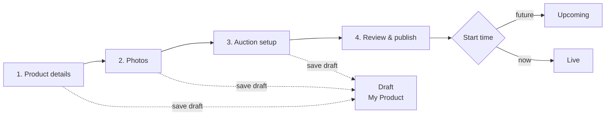

# M2 — Product Onboarding Flow (Draft)

A 4-step wizard for a seller to register a product and open an auction event for it. It powers the sidebar's **Register Product** item and the **+ Create Event** button on the auctions page.

> **Status:** plan only, not implemented. **Depends on:** M1 (User Onboarding). Only confirmed members can sell.

## Flow overview



## Steps

### Step 1 — Product details (ข้อมูลสินค้า)

| Field | Input | Validation |
|---|---|---|
| Title | text | Required, 5–80 characters |
| Category | select | One of: กล้อง, นาฬิกา, เครื่องดนตรี, กีฬา, ของสะสม, ไอที, เฟอร์นิเจอร์, ศิลปะ, ยานพาหนะ, อื่นๆ |
| Condition | radio | `new`, `like_new`, `used`, `for_parts` |
| Description | textarea | Required, 20–2,000 characters |

### Step 2 — Photos (รูปภาพ)

- 1–8 images using Active Storage, JPG/PNG/WebP, each ≤ 5 MB
- The first image is the cover (shown on catalog cards); images can be reordered by dragging
- Before there's a photo, the card falls back to the category emoji (the current mock behaviour)

### Step 3 — Auction setup (ตั้งค่าการประมูล)

| Field | Applies to | Validation |
|---|---|---|
| Auction type | all | `English` (price goes up), `Dutch` (price goes down), `Sealed` (sealed bids) |
| Starting price (฿) | all | Whole number ≥ 1 |
| Minimum increment (฿) | English | ≥ 1; default 5% of the starting price, rounded |
| Reserve price (฿) | English, Sealed | Optional; must be ≥ the starting price; hidden from bidders |
| Price drop (฿) per interval / floor price | Dutch | Drop ≥ 1; floor < starting price; interval of 5, 15 or 60 minutes |
| Start at | all | Now or later, up to 30 days ahead |
| Stop at | all | 1 hour to 14 days after start |

### Step 4 — Review & publish (ตรวจสอบและเผยแพร่)

- A preview of the catalog card, built from the same view code as the real catalog card (M3)
- A summary of every field, with **Edit** links back to each step
- A required checkbox: the seller confirms they own the item and it is described honestly
- **Publish** sets the status to `upcoming` or `live`, depending on the start time

## Product lifecycle

| Status | Meaning | Seller can edit? |
|---|---|---|
| `draft` | Wizard not finished | Everything |
| `upcoming` | Published, not started | Everything except auction type; can cancel |
| `live` | Accepting bids | Description and photos only; can't cancel once there's a bid |
| `ended` | Closed; winner decided by M4 | Nothing |
| `cancelled` | Withdrawn before any bid | Nothing |

## Data model (first real tables)

```
products: id, seller_id → users, title, category, condition, description,
          status, created_at, updated_at   (+ has_many_attached :photos)
auctions: id, product_id, auction_type, start_price, min_increment,
          reserve_price, drop_amount, drop_interval_minutes, floor_price,
          start_at, stop_at, current_price, winner_id, closed_at
```

`AuctionsController#mock_auctions` is replaced by `Auction` queries. The existing `STATUSES` / `TYPES` constants move onto the model.

## Routes

| Method | Path | Purpose |
|---|---|---|
| GET | `/products/new` | Starts a draft and goes to step 1 |
| GET/PATCH | `/products/:id/setup/:step` | Wizard steps (`details`, `photos`, `auction`, `review`) |
| POST | `/products/:id/publish` | Publish |
| GET | `/my/products` | Seller's products in every status (sidebar **My Product**) |
| POST | `/products/:id/cancel` | Cancel (only before any bid) |

## Tests

- Validations for each step and auction type, including that the reserve can't be below the starting price and the floor must be below the starting price
- Publish sets the status to `upcoming` or `live` based on `start_at`
- Edit limits for each status; can't cancel after the first bid
- A user who hasn't finished M1 is sent to `/onboarding`

## Open questions

1. Does an item need admin approval before it goes live?
2. Is there a listing fee or a commission on the final price?
3. Should one product be relisted as a new auction if it doesn't sell?
4. Which categories are prohibited (e.g. amulets need a certificate?)
